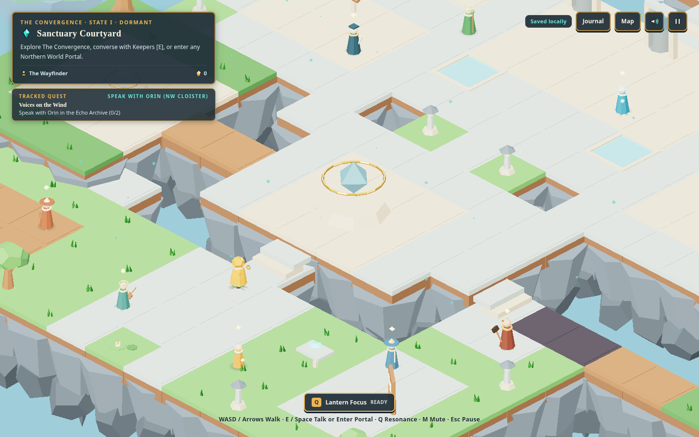
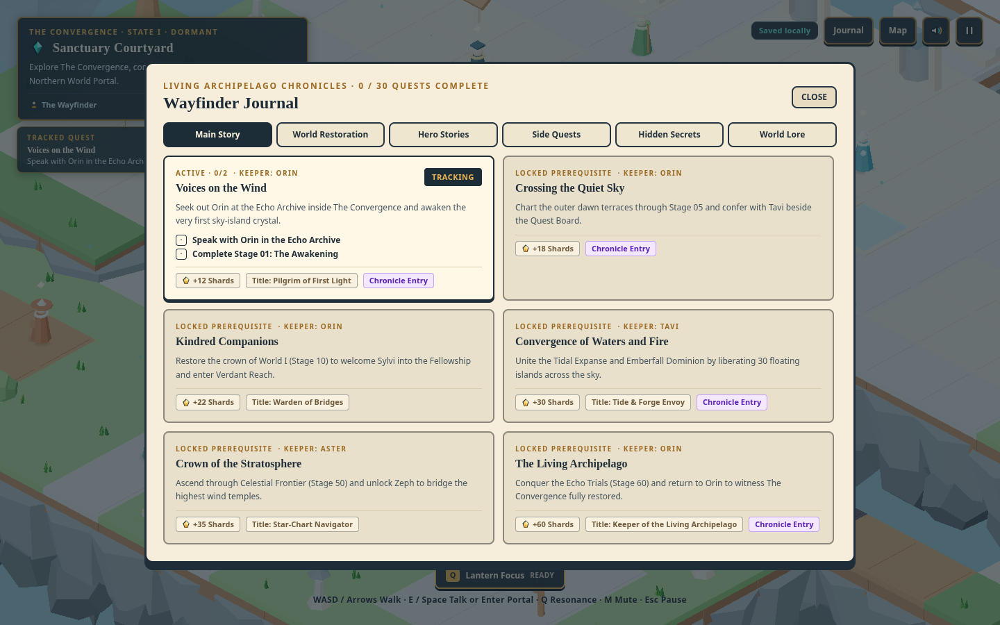

# LUMA: Floating Worlds — UNBOUND

**LUMA: Floating Worlds** is an atmospheric isometric 3D puzzle adventure and community creation sandbox set across six fractured sky archipelagos and a central living sanctuary island. Guide five heroes across 60 handcrafted campaign islands, harness **Echo Engine** time-loop recordings and **Hero Synergy**, build and verify custom islands in **World Forge**, challenge **Daily Rifts**, and race asynchronous **Echo Duels**.

Built with React 19, TypeScript, Tailwind CSS v4, Three.js (`@react-three/fiber`), procedural Web Audio, and a strict **Zero Login · Zero Database · Zero Tracking · Zero External CDNs** local-first architecture.

---

## Gameplay Screenshots

| Title Screen | The Convergence (3D Sanctuary Hub) |
| :---: | :---: |
|  |  |

| Wayfinder Journal (30 Quests) | Interactive World Map (6 Worlds / 60 Stages) |
| :---: | :---: |
|  |  |

| Stage 01: The Awakening Gameplay |
| :---: |
|  |

---

## LUMA: UNBOUND — Major Creation & Replayability Expansion

### 1. Echo Engine — Time Manipulation
- Record and play back up to **3 translucent cyan Echo ghosts** on a deterministic **30 Hz fixed-timestep simulation** (`[F]` to Record / Rewind to Anchor, timeline controls to Play/Pause, adjust Time Offset `0s..+3s`, or Clear slots).
- Step on **Echo-Only Plates** (`echoOnly: true`) and split temporal duties between your live hero and past Echoes without ever duplicating Echo Fragments, completing Portals via ghosts, or exploiting campaign rewards.

### 2. World Forge — Full 3D Isometric Stage Editor
- Design custom stages in 3D using **Small (9×9)**, **Medium (13×13)**, **Large (17×17)**, and **XL (21×21)** presets, terrain brushes, elevation (`0..3`), stairs, decor props, switches, echo plates, gates, lifts, rotating bridges, emitters/prisms/sub-crystals, and synergy nodes.
- Includes **Undo/Redo**, **Copy/Paste Tile**, **Connection Linker**, a **Bounded BFS Stage Validator** (`VALID` / `INVALID` / `WARNING` / `UNVERIFIED`), and instant **Test Play** (Playtest runs intentionally award zero campaign stars/shards).
- See [WORLD_FORGE.md](./WORLD_FORGE.md) for the complete builder guide.

### 3. Community Foundry & Portable `.luma` Formats
- Browse **Featured Creations** (5 curated showcase stages), **My Creations**, **Imported Stages**, **Stage Packs**, **Saved Replays**, **Favorites**, and **Recent**.
- Share and import **`.luma`** stages, **`.luma-pack`** collections, and **`.luma-replay`** runs 100% locally with strict schema validation and prototype-pollution/XSS/URL sanitization.
- See [CUSTOM_LEVEL_FORMAT.md](./CUSTOM_LEVEL_FORMAT.md) for format specifications.

### 4. Echo Duels — Asynchronous Ghost Racing & PNG Scorecards
- Import any `.luma-replay` or challenge the bundled **Astral Mirror Duet** rival to race a non-colliding amber-violet **Duel Ghost** in real time.
- Displays honest verification badges (**Deterministically Verified** vs **Unverified Visual Reference**) and exports downloadable **HTML5-Canvas PNG Scorecards** completely offline.

### 5. Daily Rift — Seeded Daily, Weekly & Monthly Challenges
- Deterministic PRNG (`mulberry32`) generates **Daily**, **Weekly**, and **Monthly** rifts across 7 challenge modifiers (`Standard`, `Limited Action`, `Time Attack`, `No Echo`, `Hero Ability`, `Minimal Movement`, `No Hint`) verified by the BFS solver.
- Share and load deterministic challenge codes (`LUMA-RIFT-...`) with local streak and best-clear tracking.

### 6. Hero Synergy (2-Hero Party Mode)
- On custom and synergy stages, bring a companion hero alongside your lead (`[Tab]` to Swap control, `[H]` to toggle Companion Follow vs Hold Position for **Hero Relay** puzzles).
- Signature pair abilities: **Sylvi + Neris** (*Root-Waterway*), **Kael + Neris** (*Steam-Forge Lift*), and **Zeph + Wayfinder** (*Wind-Rune Relay*).

---

## Core Campaign & Sanctuary Features

- **The Convergence (3D Sanctuary Hub):** Explore interconnected Sanctuary Courtyard, Central Sanctuary, Hero Sanctum, Wardrobe Atelier, Echo Archive, Quest Board, and Eastern Alcove evolving across **Dormant → Awakening → Restored**.
- **6 Worlds · 60 Handcrafted Stages:** Rotating bridges, pressure gates, elevation lifts, prism light beams, hero resonance nodes, **180 Mastery Stars**, and **60 Echo Fragments**.
- **5 Playable Heroes & 51 Cosmetics:** *The Wayfinder*, *Sylvi*, *Neris*, *Kael*, and *Zeph*, plus cloaks, lanterns, headwear, backpacks, celestial auras, and dye palettes.
- **10 Living NPCs & 30 Quests:** Branching reactive dialogue and a 6-Tab Living Journal.
- **Mid-Run Checkpoints & Lossless Save Migration:** Automatic `v1/v2/v3 → v4` save migration, atomic dual-key `localStorage` persistence, and full JSON export/import.

---

## Controls

| Action | Input |
| :--- | :--- |
| Move | `W` `A` `S` `D` or Arrow Keys |
| Interact / Speak / Activate | `E` or `Space` |
| Hero Resonance Ability | `Q` |
| Echo Record / Rewind Anchor (Unbound Stages) | `F` |
| Swap Lead Hero (2-Hero Synergy Stages) | `Tab` |
| Toggle Companion Follow / Hold Position | `H` |
| Restart Current Island | `R` |
| Pause / Hub Menu | `Esc` or `P` |
| Mute Audio | `M` |

---

## Privacy & Local-First Guarantee

LUMA operates with **zero login, zero accounts, zero external servers, zero analytics, and zero third-party CDNs**. All progress, custom stages, replays, and streaks live exclusively in your browser's `localStorage`. See [PRIVACY.md](./PRIVACY.md) for full technical details.

---

## Development & Static Deployment

```bash
npm install
npm run dev       # Local development server on port 3000
npx --yes tsx --test src/game/*.test.ts src/dev/devSuite.test.ts  # Unit tests
npm run lint      # TypeScript typecheck
npm run build     # Production static bundle in ./dist (relative ./ paths)
```

Because `vite.config.ts` uses `base: './'` and bundles all assets locally without external network dependencies, the compiled `./dist` directory can be hosted directly on **GitHub Pages**, **Cloudflare Pages**, **Netlify**, **Vercel**, or any static file server.

See [CONTRIBUTING.md](./CONTRIBUTING.md) for development conventions.

---

## License

No `LICENSE` file is currently included in this repository root. Unless a license file is added by the repository owner, standard default copyright applies and no open-source grant should be assumed.
