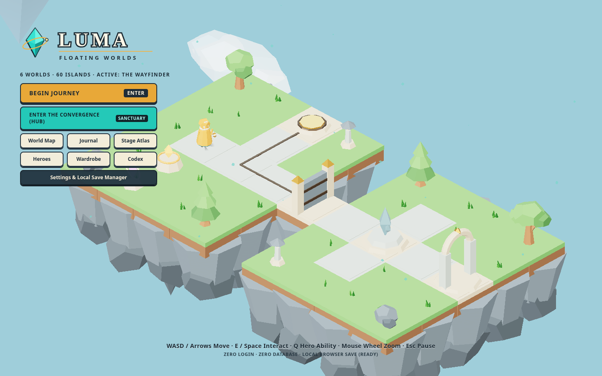
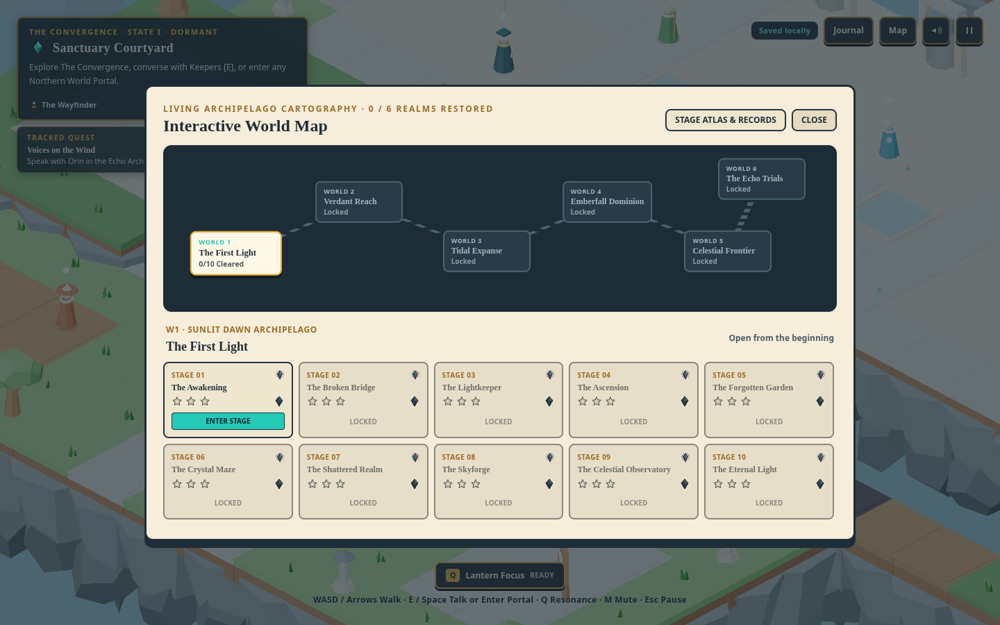
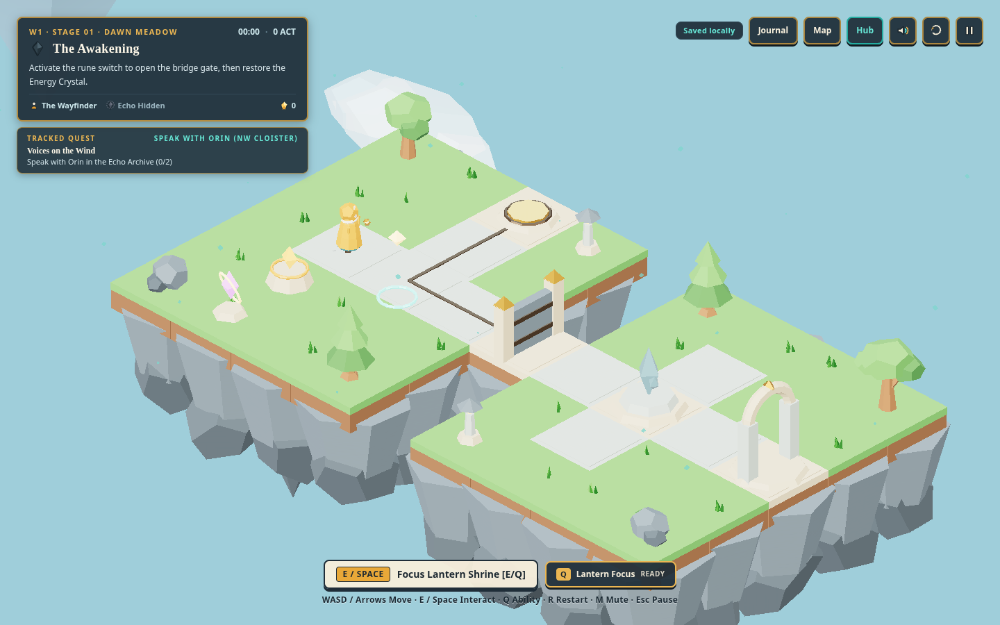

# LUMA: Floating Worlds — The Living Archipelago

**LUMA: Floating Worlds** is an atmospheric isometric 3D puzzle adventure set across six fractured sky archipelagos and a central living sanctuary island. Guide the Wayfinder and four fellow heroes through 60 handcrafted islands, restore ancient beacons, speak with sanctuary keepers, complete 30 chronicles, and awaken **The Convergence**.

Built with React 19, TypeScript, Tailwind CSS, Three.js (`@react-three/fiber`), procedural Web Audio, and a strict **Zero Login · Zero Database · Zero Tracking** local-first architecture.

---

## Gameplay Screenshots

| Title Screen | The Convergence (3D Sanctuary Hub) |
| :---: | :---: |
|  |  |

| Wayfinder Journal (30 Quests) | Interactive World Map (6 Worlds / 60 Stages) |
| :---: | :---: |
|  |  |

| Stage 01: The Awakening Gameplay |
| :---: |
|  |

---

## Core Features

### 1. The Convergence (Interactive 3D Sanctuary Hub)
Walk freely across a multi-elevation central hub island divided into interconnected zones:
- **Sanctuary Courtyard & Sixfold Portal Arc** — Approach any of the six sky-gates to enter unlocked Worlds directly.
- **Central Sanctuary** — Commune with the Giant Central Crystal to inspect the connected World Map.
- **Hero Sanctum** — Switch between the 5 playable heroes (*The Wayfinder*, *Sylvi*, *Neris*, *Kael*, *Zeph*).
- **Wardrobe Atelier** — Equip star milestone cloaks, lanterns, headwear, backpacks, celestial auras, and dye palettes across 51 cosmetics.
- **Echo Archive & Reward Gallery** — Review collected Echo Fragments, Trophies, and Mastery Milestones.
- **Cartographer Quest Board** — Open the 6-Tab Living Journal.
- **Forgotten Eastern Alcove** — Cross the stepping-stone causeway to uncover a quiet shrine.

As you complete campaign stages and restoration chronicles, **The Convergence** evolves across three visual tiers: **Dormant → Awakening → Restored**, bringing light bridges, glowing lanterns, and floating blossoms back to life.

### 2. 10 Living NPCs & Branching Dialogue
Speak with 10 distinct characters across the Sanctuary—**Orin**, **Sera**, **Talen**, **Mira**, **Veyra**, **Brann**, **Lyra**, **Kori**, **Solon**, and **Elowen**. Each features reactive dialogue tied to your active hero, restoration tier, Echo count, and quest progression.

### 3. 30 Quests & 6-Tab Living Journal
Track chronicles, view multi-step checklists, claim one-time Shard & Title rewards, and browse world lore inside the Journal:
- **Main Story** (6)
- **World Restoration** (6)
- **Hero Stories** (5)
- **Side Quests** (8)
- **Hidden Secrets** (5 — obscured until discovered)
- **World Lore** (Chronicles, Echo Codex & Unlocked Titles)

### 4. World Restoration, Connected World Map & 60 Stages
Traverse all **6 Worlds** and **60 Stages** with rotating bridges, pressure gates, elevation lifts, prism light beams, hero resonance nodes, 180 Mastery Stars, and 60 Echo Fragments. Restoring a World visually uplifts its sky, ambient light, fog clarity, crystal resonance, and water luminescence.

### 5. Mid-Run Checkpoints, Session History & Local Save Manager
- **Mid-Run Checkpoints**: Pause and choose **Save Checkpoint & Enter Hub**, or hide/leave the browser tab—your hero coordinates, timer, action count, switches, lifts, bridges, and prism rotations save locally so you can resume right where you left off.
- **Session History**: Keeps up to 5 recent run summaries per stage (clear time, actions, stars, Echo status, outcome).
- **Backup & Recovery**: Every save writes atomically with an automatic backup snapshot and Schema v1/v2 → v3 lossless migration.
- **Export / Import JSON**: Back up your journey to a `.json` file or transfer it to another browser with full validation preview before applying.

---

## Controls

| Action | Input |
| :--- | :--- |
| Move | `W` `A` `S` `D` or Arrow Keys |
| Interact / Speak / Activate | `E` or `Space` |
| Hero Resonance Ability | `Q` |
| Restart Current Island | `R` |
| Pause / Hub Menu | `Esc` or `P` |
| Mute Audio | `M` |

---

## Privacy & Local-First Guarantee

LUMA operates with **zero login, zero accounts, zero external servers, zero analytics, and zero third-party CDNs**. All progress lives exclusively in your browser's `localStorage`. See [PRIVACY.md](./PRIVACY.md) for full technical details.

---

## Development & Static Deployment

```bash
npm install
npm run dev       # Local development server on port 3000
npm run lint      # TypeScript typecheck
npm run build     # Production static bundle in ./dist (relative ./ paths)
```

Because `vite.config.ts` uses `base: './'` and bundles all assets locally without external network dependencies, the compiled `./dist` directory can be hosted directly on **GitHub Pages**, **Cloudflare Pages**, **Netlify**, **Vercel**, or any static file server.

---

## License

No `LICENSE` file is currently included in this repository root. Unless a license file is added by the repository owner, standard default copyright applies and no open-source grant should be assumed.
